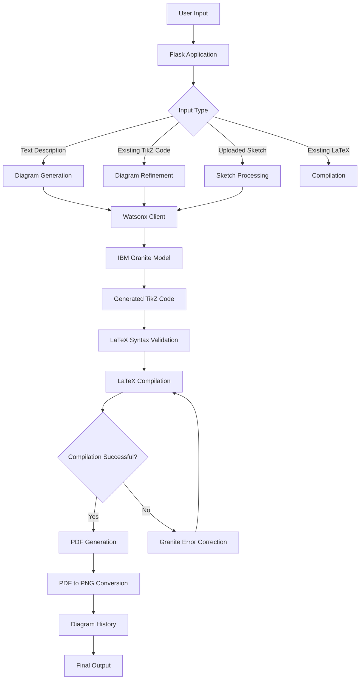

# DiagramAI — AI-Powered LaTeX Diagram Generator for Academic Research

<p align="center">
  <strong>Transform Research Ideas into Publication-Ready Diagrams with AI.</strong>
</p>

<p align="center">
  Python · Flask · IBM Granite · IBM watsonx.ai · LaTeX · TikZ · Docker
</p>

---

## Overview

**DiagramAI** is an AI-powered academic diagram generation application that converts natural-language descriptions into structured, compilable LaTeX/TikZ code.

Developed using Python, Flask, IBM watsonx.ai, and IBM Granite foundation models, the application simplifies the process of creating professional diagrams for academic research, technical documentation, and scientific publications.

Instead of manually writing complex TikZ code, researchers can describe their requirements in plain English, generate diagrams, refine them through conversational instructions, and compile the resulting code into visual outputs.

The system also incorporates LaTeX syntax validation, automated error correction, diagram optimization, and session-based version history to support an end-to-end diagram generation workflow.

## Problem Statement

Creating publication-quality diagrams using LaTeX/TikZ requires considerable technical knowledge and manual coding effort.

Researchers frequently need diagrams such as neural networks, flowcharts, circuit diagrams, system architectures, and other technical illustrations.

DiagramAI addresses this challenge by introducing an intelligent AI-assisted workflow that reduces manual coding complexity and makes professional diagram generation more accessible.

## Key Features

### 1. AI-Powered Diagram Generation
- Converts natural-language descriptions into complete LaTeX/TikZ documents.
- Uses IBM Granite foundation models through IBM watsonx.ai.
- Automatically detects diagram types using keyword-based classification.
- Generates structured code with academic formatting conventions.

### 2. Multiple Diagram Types

The agent instructions define support for:

- Flowcharts
- Neural networks
- Block diagrams
- Circuit diagrams
- Venn diagrams
- State machines
- Sequence diagrams
- Tree diagrams
- Bar charts
- Line graphs
- Scatter plots
- Architecture diagrams
- Entity-Relationship (ER) diagrams
- UML class diagrams
- Timelines
- Gantt charts
- Mind maps

### 3. Conversational Diagram Refinement
- Accepts plain-English modification instructions.
- Updates existing TikZ code without requiring manual editing.
- Supports refinement hints for common layout and styling changes.
- Returns the complete modified LaTeX document.

### 4. Automated LaTeX Validation and Error Correction
- Performs static syntax validation.
- Detects missing document and TikZ environments.
- Identifies unbalanced LaTeX environments.
- Extracts relevant compiler errors.
- Uses IBM Granite to suggest corrected LaTeX code.
- Automatically retries compilation after correction.

### 5. Diagram Compilation and Rendering
- Compiles LaTeX documents using Tectonic or pdflatex.
- Supports an optional external compilation microservice.
- Generates PDF outputs.
- Converts compiled PDFs into PNG previews using Poppler.

### 6. Academic Style Profiles

DiagramAI includes predefined formatting profiles:

| Profile | Description |
|---|---|
| IEEE | IEEE Transactions and Conference style |
| ACM | ACM publication style |
| Springer | Springer LNCS / Nature style |
| Custom | General-purpose diagram formatting |

The default active profile is IEEE.

### 7. Diagram Optimization
- Analyzes diagram readability and spacing.
- Generates improvement suggestions.
- Produces an improved version of the TikZ code.

### 8. Sketch Upload Workflow
- Accepts uploaded diagram images.
- Supports PNG, JPG, JPEG, GIF, BMP, WEBP, and SVG file extensions.
- Accepts accompanying descriptions or OCR text.
- Uses the supplied textual description to generate a corresponding TikZ representation.

### 9. Diagram History Management
- Maintains session-based diagram history.
- Stores prompts, diagram types, LaTeX code, explanations, and output paths.
- Supports retrieving previous versions.
- Allows individual deletion and complete history clearing.
- Maintains up to 50 versions per session by default.

### 10. Export and Download
Supports downloading generated diagrams as:

- `.tex` — LaTeX source code
- `.pdf` — Compiled diagram
- `.png` — Rendered diagram preview

---

## System Architecture

DiagramAI follows a modular architecture that separates AI inference, application logic, LaTeX processing, and diagram history management.



## Technology Stack

| Component | Technology | Purpose |
|---|---|---|
| Programming Language | Python | Application development |
| Backend Framework | Flask | API development and application routing |
| AI Foundation Model | IBM Granite | Diagram generation, refinement, and correction |
| AI Platform | IBM watsonx.ai | Foundation model access |
| AI Integration | IBM watsonx.ai Python SDK | Model inference |
| Diagram Language | LaTeX / TikZ | Structured diagram representation |
| LaTeX Compiler | Tectonic / pdflatex | LaTeX compilation |
| PDF Processing | Poppler | PDF-to-PNG conversion |
| HTTP Communication | Requests | External compilation service |
| Environment Management | python-dotenv | Environment variable configuration |
| Production Server | Gunicorn | WSGI application serving |
| Containerization | Docker | Application packaging |
| Cloud Infrastructure | IBM Cloud | AI and application infrastructure |

---

## Application Workflow

### Step 1 — User Input

The user provides a natural-language description of the required diagram.

Example:

```text
Create a neural network architecture with
three input neurons, four hidden neurons,
and two output neurons.
```

### Step 2 — Diagram Type Detection

The application identifies the likely diagram category through keyword-based classification.

Users can also provide a diagram type explicitly.

### Step 3 — Prompt Construction

The `agent_instructions.py` module provides:

- Agent persona and instructions.
- Supported diagram types.
- LaTeX/TikZ coding standards.
- Academic formatting profiles.
- Diagram-specific templates.
- Refinement hints.
- Error correction instructions.

These instructions are used to construct the system prompt.

### Step 4 — IBM Granite Inference

The `watsonx_client.py` module connects to IBM watsonx.ai using the IBM Cloud API key and project ID.

The Granite model processes the request and generates LaTeX/TikZ code with an accompanying explanation.

### Step 5 — Syntax Validation

The `latex_service.py` module checks the generated document for potential structural issues, including missing environments and unbalanced LaTeX blocks.

### Step 6 — Compilation

The generated code is passed to the configured LaTeX compiler.

Supported backends:

- Tectonic
- pdflatex
- External compilation microservice

### Step 7 — Automated Error Correction

If compilation fails, the application sends the generated code and compiler error log to IBM Granite.

The corrected code is compiled again.

### Step 8 — Rendering

The successfully compiled PDF can be converted into a PNG preview using `pdf2image` and Poppler.

### Step 9 — History Management

The generated diagram, source code, explanation, prompt, and output paths are stored in session-based history.

---

## Installation and Setup

### Prerequisites

Ensure the following are installed:

- Python 3.11 or compatible version
- pip
- IBM Cloud account
- IBM watsonx.ai access
- LaTeX compiler (Tectonic or pdflatex)
- Poppler
- Git

### 1. Clone the Repository

```bash
git clone https://github.com/lavishaoberoi/AI-Powered-LaTeX-Diagram-Generator-for-Academic-Research.git

cd AI-Powered-LaTeX-Diagram-Generator-for-Academic-Research
```

### 2. Create a Virtual Environment

```bash
python -m venv .venv
```

**Windows:**

```bash
.venv\Scripts\activate
```

**macOS / Linux:**

```bash
source .venv/bin/activate
```

### 3. Install Python Dependencies

```bash
pip install -r requirements.txt
```

### 4. Install Tectonic

**Windows:**

```bash
choco install tectonic
```

**macOS:**

```bash
brew install tectonic
```

**Linux:**

```bash
curl --proto '=https' --tlsv1.2 -fsSL https://drop.rust-lang.org/tectonic-installer.sh | sh
```

### 5. Install Poppler

**Windows:**

Download from:

https://github.com/oschwartz10612/poppler-windows/releases

**macOS:**

```bash
brew install poppler
```

**Ubuntu / Debian:**

```bash
sudo apt-get install poppler-utils
```

### 6. Configure Environment Variables

Create your environment file:

```bash
cp .env.example .env
```

Configure the following variables:

```env
# IBM Cloud
IBM_CLOUD_API_KEY=your_ibm_cloud_api_key
IBM_CLOUD_URL=https://us-south.ml.cloud.ibm.com

# watsonx.ai
WATSONX_PROJECT_ID=your_project_id
GRANITE_MODEL_ID=ibm/granite-13b-instruct-v2

# Flask
FLASK_SECRET_KEY=your_secure_secret_key
FLASK_ENV=development
FLASK_DEBUG=1
FLASK_PORT=5000

# LaTeX
LATEX_COMPILER=tectonic

# Storage
UPLOAD_FOLDER=uploads
OUTPUT_FOLDER=outputs
MAX_CONTENT_LENGTH=16777216

# History
DIAGRAM_HISTORY_LIMIT=50
```

**Security:** Never commit your `.env` file or expose your IBM Cloud API key in a public repository.

### 7. Run the Application

```bash
python app.py
```

Open the application:

```text
http://localhost:5000
```

---

## API Endpoints

DiagramAI exposes the following Flask API endpoints.

| Method | Endpoint | Description |
|---|---|---|
| GET | `/` | Loads the application interface |
| POST | `/api/generate` | Generates diagrams from text descriptions |
| POST | `/api/refine` | Refines existing diagrams |
| POST | `/api/compile` | Compiles custom LaTeX code |
| POST | `/api/sketch` | Uploads and processes diagram sketches |
| POST | `/api/optimize` | Suggests diagram improvements |
| GET | `/api/history` | Retrieves session history |
| GET | `/api/history/<diagram_id>` | Retrieves a specific diagram |
| DELETE | `/api/history/<diagram_id>` | Deletes a specific diagram |
| DELETE | `/api/history` | Clears session history |
| GET | `/api/download/tex/<diagram_id>` | Downloads LaTeX source |
| GET | `/api/download/pdf/<diagram_id>` | Downloads compiled PDF |
| GET | `/api/download/png/<diagram_id>` | Downloads PNG output |
| GET | `/api/health` | Checks application status |

### Example: Generate a Diagram

**Request:**

```http
POST /api/generate
Content-Type: application/json
```

```json
{
  "description": "Create a neural network with three input neurons, four hidden neurons and two output neurons.",
  "style_profile": "ieee",
  "diagram_type": "neural_network",
  "auto_compile": true
}
```

The response includes:

- Generated LaTeX code.
- AI-generated explanation.
- Detected diagram type.
- Compilation status.
- Error information, if applicable.
- PNG preview as Base64 data, when available.
- Diagram ID and version.

---

## IBM watsonx.ai Integration

DiagramAI uses IBM watsonx.ai to access IBM Granite foundation models.

The integration is implemented in `watsonx_client.py` using:

```python
from ibm_watsonx_ai import Credentials
from ibm_watsonx_ai.foundation_models import ModelInference
```

The application initializes the Granite model with configurable generation parameters, including:

- Maximum new tokens: 2048
- Minimum new tokens: 50
- Temperature: 0.2
- Top-p: 0.9
- Repetition penalty: 1.1

The default model configuration is:

```env
GRANITE_MODEL_ID=ibm/granite-13b-instruct-v2
```

The model ID can be changed through environment configuration, subject to model availability and account access.

---

## Docker Deployment

DiagramAI includes a Dockerfile for containerized deployment.

Build the Docker image:

```bash
docker build -t diagramai .
```

Run the container:

```bash
docker run -p 5000:5000 --env-file .env diagramai
```

Access the application:

```text
http://localhost:5000
```

The Docker configuration includes:

- Python 3.11 slim base image.
- Python dependency installation.
- Tectonic LaTeX compiler.
- Poppler utilities.
- Upload and output directories.
- Gunicorn production server.

## IBM Cloud Deployment

The application is designed to support deployment using IBM Cloud and IBM Code Engine.

The deployment workflow includes:

1. IBM Cloud account configuration.
2. watsonx.ai project setup.
3. IBM Cloud API key configuration.
4. Docker image creation.
5. IBM Container Registry integration.
6. Code Engine secret configuration.
7. Application deployment.
8. Public endpoint generation.

For detailed deployment instructions, refer to:

**[DEPLOYMENT.md](DEPLOYMENT.md)**

---

## Project Information

| Attribute | Details |
|---|---|
| Project Name | DiagramAI |
| Project Domain | Research / Academic Research / Education |
| Problem Statement | AI-Powered LaTeX Diagram Generator for Academic Research |
| Problem Statement Number | 26 |
| AI Platform | IBM watsonx.ai |
| Foundation Model | IBM Granite |
| Backend | Python / Flask |
| Diagram Language | LaTeX / TikZ |
| Deployment | Docker / IBM Cloud Code Engine |

## Author

**Lavisha Oberoi**

B.Tech — Computer Science and Engineering (AI & ML)

- GitHub: [@lavishaoberoi](https://github.com/lavishaoberoi)
- LinkedIn: [Lavisha Oberoi](https://www.linkedin.com/in/lavisha-oberoi/)

---

## Acknowledgements

- IBM for IBM Granite foundation models and watsonx.ai.
- IBM University Engagement Program.
- Edunet Foundation.
- The Python, Flask, LaTeX, and TikZ open-source communities.

---

<p align="center">
  <strong>DiagramAI — From Natural Language to Publication-Ready Diagrams.</strong>
</p>
